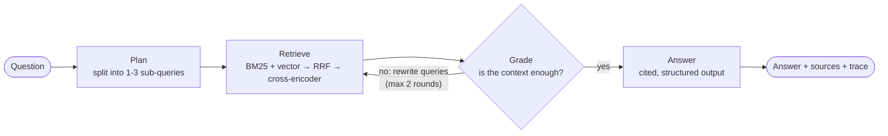
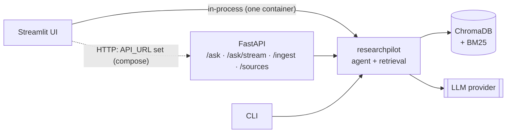

# ResearchPilot

[](https://github.com/Yarthik/research-pilot/actions/workflows/ci.yml)


**An agentic research assistant over your own documents.** Ingest PDFs and web pages, ask questions, and get answers with inline citations. A LangGraph agent plans its searches, checks whether what it found is enough, and searches again when it isn't.

**Live demo:** _add your Hugging Face Space link here_ · **API docs:** `/docs` on any running API

## Highlights

- **Self-correcting LangGraph agent**: plan → retrieve → grade → (retrieve again | answer), with a full step trace streamed to the UI
- **Hybrid retrieval**: BM25 (implemented from scratch) + dense vectors (ChromaDB), merged with Reciprocal Rank Fusion, then re-ranked by a cross-encoder
- **Grounded answers**: structured output, inline citations validated against the sources, and an explicit "not in the documents" path
- **Evaluation harness**: retrieval benchmark across four retrieval modes, and LLM-judged correctness, faithfulness, abstention and a retry ablation, written straight into this README
- **Production shape**: FastAPI service (streaming endpoint, API-key auth, read-only mode), Streamlit UI, Docker + compose, Hugging Face Spaces deployment, GitHub Actions CI
- **Any LLM**: Groq, OpenAI, Anthropic, Google or local Ollama through one setting; embeddings and reranking run locally on CPU for free

## How it works



**Ingestion:** `PDF / URL / text → extraction (pypdf, trafilatura) → sentence-aware chunking with overlap, page numbers kept → local embeddings (bge-small) → ChromaDB + BM25 index`

**Retrieval modes** (selectable per request): `vector`, `bm25`, `hybrid` (RRF), `hybrid_rerank` (default).

**Serving:**



## Quickstart

Requires Python 3.12+.

```bash
git clone https://github.com/Yarthik/research-pilot.git
cd research-pilot
python -m venv .venv && source .venv/bin/activate     # Windows: .venv\Scripts\activate
pip install -r requirements.txt
cp .env.example .env                                   # add GROQ_API_KEY (free at console.groq.com)

python -m researchpilot ingest --file data/sample_sources.txt   # 5 well-known AI papers from arXiv
python -m researchpilot ask "How does LoRA reduce the number of trainable parameters?" --trace
```

The first run downloads the local embedding and reranker models (about 150 MB).

`--trace` prints the agent's steps. The format looks like this (values vary by question and model):

```
plan:     queries=['ReAct prompting', 'chain-of-thought prompting'], needs_web=False
retrieve: round=1, mode=hybrid_rerank, new_chunks=10, kept_new=10, evidence=10
grade:    sufficient=True
generate: sources=10, cited=[1, 2, 6, 7]
```

### Web UI

```bash
streamlit run app/streamlit_app.py        # http://localhost:8501
```

Chat with your documents, watch the agent's steps live, expand each citation to see the exact passage and page, switch retrieval modes, and upload PDFs or add URLs from the sidebar.

### API

```bash
uvicorn researchpilot.api.main:app --port 8000     # interactive docs at http://localhost:8000/docs
```

| Method | Path | Purpose |
| --- | --- | --- |
| `GET` | `/health` | Status, chunk count, configured LLM and retrieval mode |
| `POST` | `/ask` | `{"question", "mode"?, "max_rounds"?}` → answer, citations, trace |
| `POST` | `/ask/stream` | Same, as newline-delimited JSON: one event per agent step, then the result |
| `POST` | `/ingest/urls` | `{"urls": [...]}` web pages or PDF links |
| `POST` | `/ingest/files` | Multipart upload of PDF / TXT / MD files |
| `GET` | `/sources` | Ingested documents |
| `DELETE` | `/sources?source=...` | Remove a document |

```bash
curl -s localhost:8000/ask -H 'Content-Type: application/json' \
  -d '{"question": "What are RAG-Sequence and RAG-Token?"}' | jq '.answer, .citations[].title'
```

Set `API_KEY` to require an `X-API-Key` header, and `ALLOW_INGEST=false` to make the corpus read-only for a public demo.

### Docker

```bash
docker compose up --build      # UI on :8501, API on :8000, sample papers ingested on first start
```

The compose setup runs the UI and API as separate services; the UI talks to the API over HTTP, and the API owns the document index. For a single container (what Hugging Face Spaces runs): `docker build -t researchpilot . && docker run -p 7860:7860 --env-file .env researchpilot`.

**Deploying the live demo** to a free Hugging Face Space takes about five minutes: see [docs/DEPLOY.md](docs/DEPLOY.md).

## Evaluation

The `evals/` harness measures the system rather than eyeballing it. The labelled set ([evals/dataset.jsonl](evals/dataset.jsonl)) has 29 questions over the five sample papers: 21 single-document, 4 multi-document and 4 unanswerable (the answer isn't in the corpus, so the right response is to say so).

**Retrieval** (no LLM calls, free): for each question, a retrieved chunk counts as relevant if it comes from the expected paper and contains one of the labelled key phrases. Reports hit rate@5, MRR@5 and, for multi-document questions, how many of the needed papers were found.

<!-- EVAL:RETRIEVAL:START -->
| Retrieval mode | Hit rate@5 | MRR@5 | Multi-doc source recall@5 | p50 latency |
| --- | ---: | ---: | ---: | ---: |
| Vector only | 92.0% | 0.708 | 62.5% | 10 ms |
| BM25 only | 88.0% | 0.803 | 75.0% | 1 ms |
| Hybrid (RRF) | 96.0% | 0.831 | 75.0% | 11 ms |
| Hybrid + rerank | 96.0% | 0.685 | 87.5% | 1050 ms |

_25 labelled questions · embeddings `BAAI/bge-small-en-v1.5` · reranker `Xenova/ms-marco-MiniLM-L-6-v2` · chunks 1000/150 chars · run 2026-10-04 18:04 UTC_
<!-- EVAL:RETRIEVAL:END -->

**Answers** (uses the LLM): runs the full agent and scores each answer with an LLM judge for **correctness** against a reference answer (correct = 1, partially = 0.5), **faithfulness** (share of the answer's claims supported by the passages it cites), citation coverage, whether it **abstains** on unanswerable questions, and false abstentions. The ablation compares one retrieval round against the self-correcting two-round loop.

<!-- EVAL:ANSWERS:START -->
_Not run yet. Run `python -m evals answers --compare-retry --update-readme` to fill in this table._
<!-- EVAL:ANSWERS:END -->

```bash
python -m evals retrieval --update-readme                         # ~1 minute on CPU
python -m evals answers --compare-retry --delay 2 --update-readme # ~10 LLM calls per question per config
```

Notes: the answer eval makes roughly 10 LLM calls per question per configuration, which can exceed a free tier's daily limit. Use `--limit 10` to run a subset, or point `JUDGE_PROVIDER` / `JUDGE_MODEL` at a stronger or cheaper model. Using the same model as both agent and judge can flatter the scores; a different, stronger judge is more trustworthy. Results are also saved as JSON in `evals/results/` with per-question details. A weekly GitHub Action re-runs the retrieval benchmark.

## Configuration

Everything is set through environment variables or `.env` (see [.env.example](.env.example)).

| Variable | Default | Meaning |
| --- | --- | --- |
| `LLM_PROVIDER` / `LLM_MODEL` | `groq` / `openai/gpt-oss-120b` | Any of `groq`, `openai`, `anthropic`, `google_genai`, `ollama` |
| `RETRIEVAL_MODE` | `hybrid_rerank` | `vector`, `bm25`, `hybrid`, `hybrid_rerank` |
| `FINAL_K` / `CANDIDATE_K` | `5` / `20` | Chunks kept per query / candidates per retriever before fusion |
| `MAX_RETRIEVAL_ROUNDS` | `2` | `1` turns off the self-correcting retry |
| `MAX_EVIDENCE` | `15` | Chunks passed to the answer step |
| `CHUNK_SIZE` / `CHUNK_OVERLAP` | `1000` / `150` | Characters |
| `EMBEDDING_MODEL` / `RERANKER_MODEL` | `BAAI/bge-small-en-v1.5` / `Xenova/ms-marco-MiniLM-L-6-v2` | Local FastEmbed (ONNX) models |
| `TAVILY_API_KEY` | unset | Enables web search when the planner decides documents won't cover a question |
| `API_KEY`, `ALLOW_INGEST`, `MAX_UPLOAD_MB` | unset, `true`, `20` | API protection for public deployments |
| `LANGSMITH_TRACING`, `LANGSMITH_API_KEY` | unset | Send LangGraph traces to LangSmith |

Example models: OpenAI `gpt-4o-mini`, Anthropic `claude-haiku-4-5-20251001`, Ollama `llama3.1`. Model names change over time, so check your provider's list.

## Design decisions

- **Hybrid retrieval with RRF.** Dense vectors capture meaning; BM25 catches exact terms like "RAG-Token", "GSM8K" or "10,000 times" that embeddings blur. RRF merges the two rankings using ranks only, so their incompatible score scales don't matter.
- **Cross-encoder reranking.** The bi-encoder and BM25 cast a wide net (20 candidates each); a cross-encoder then reads each (question, passage) pair together and keeps the best 5. It's slower per pair, which is why it only sees the shortlist.
- **Re-scoring evidence across retry rounds.** The agent can find more chunks than fit in the answer prompt. Keeping the first N would silently discard everything a retry found, so the whole pool is re-scored against the original question and the best N kept (there's a regression test for this).
- **Bounded loop.** At most two retrieval rounds, and the grader is skipped on the last round, saving an LLM call when its verdict couldn't change anything.
- **Graceful degradation.** If a model fails structured output, each step has a fallback (raw question as the query, plain-text answer). Configuration problems such as a missing API key are the exception: they surface as a clear error instead of a degraded answer.
- **Citations are checked, not trusted.** Citation numbers are parsed from the answer text (`[1]`, `[2][3]`, `[1, 4]`, `[2-4]`) and validated against the evidence list; invalid ones are reported in the trace and counted by the eval.
- **Testable by design.** The LLM, embeddings, vector store and reranker are injectable, so the test suite runs the real agent graph, API and UI backends without API keys or model downloads.

## Project structure

```
researchpilot/
├── config.py              settings from environment / .env, validated with Pydantic
├── llm.py                 provider-agnostic chat model, retries, config-error detection
├── ingestion/             loaders (PDF, web, text), chunking, ingest pipeline
├── retrieval/             embeddings, ChromaDB store, BM25, reranker, hybrid retriever + RRF
├── agent/                 LangGraph state, prompts, schemas, nodes, graph, citations, evidence selection
├── tools/web_search.py    optional Tavily search
├── api/                   FastAPI app and request/response schemas
└── cli.py                 command-line interface
app/                       Streamlit UI + local/HTTP backends
evals/                     dataset, metrics, LLM judge, runner, README table updater
tests/                     unit + integration tests with fakes (no keys, no downloads)
deploy/, docs/, scripts/   Hugging Face Space config, deployment guide, helper scripts
```

## Development

```bash
pip install -r requirements-dev.txt
pytest -m "not slow"     # what CI runs: no API keys or downloads needed
pytest -m slow           # end-to-end retrieval with the real local models
ruff check . && ruff format --check .
```

`make help` lists shortcuts for all of the above.

## Limitations and next steps

- Scanned PDFs need OCR first (text extraction only).
- One shared index; a multi-user deployment would need per-user collections and auth.
- Answer-quality numbers depend on the LLM judge; spot-check the per-question JSON before quoting them.
- Ideas: semantic chunking, query-time metadata filters (per document), answer caching, a domain corpus such as FDA drug labels.

## License

MIT
