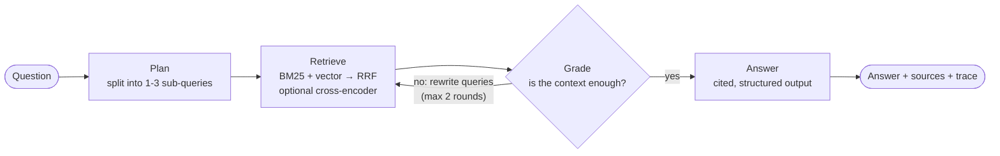
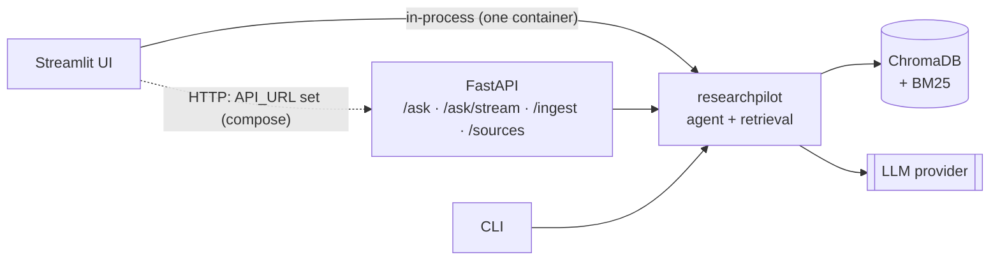

# ResearchPilot

[](https://github.com/Yarthik/research-pilot/actions/workflows/ci.yml)


**An agentic research assistant over your own documents.** Ingest PDFs and web pages, ask questions, and get answers with inline citations. A LangGraph agent plans its searches, checks whether what it found is enough, and searches again when it isn't.

**Live demo:** _add your Hugging Face Space link here_ · **API docs:** `/docs` on any running API

## Highlights

- **Self-correcting LangGraph agent**: plan → retrieve → grade → (retrieve again | answer), with a full step trace streamed to the UI
- **Hybrid retrieval**: BM25 (implemented from scratch) + dense vectors (ChromaDB), merged with Reciprocal Rank Fusion; optional cross-encoder reranking, benchmarked against plain fusion
- **Grounded answers**: structured output, inline citations validated against the sources, and an explicit "not in the documents" path
- **Evaluation harness**: retrieval benchmark across four retrieval modes, and LLM-judged correctness, faithfulness, abstention and a retry ablation, written straight into this README
- **Production shape**: FastAPI service (streaming endpoint, API-key auth, read-only mode), Streamlit UI, Docker + compose, Hugging Face Spaces deployment, GitHub Actions CI
- **Any LLM**: Groq, OpenAI, Anthropic, Google or local Ollama through one setting; embeddings and reranking run locally on CPU for free

## How it works



**Ingestion:** `PDF / URL / text → extraction (pypdf, trafilatura) → sentence-aware chunking with overlap, page numbers kept → local embeddings (bge-small) → ChromaDB + BM25 index`

**Retrieval modes** (selectable per request): `vector`, `bm25`, `hybrid` (RRF, default), `hybrid_rerank` (RRF + cross-encoder).

**Serving:**



## Quickstart

Requires Python 3.12+.

```bash
git clone https://github.com/Yarthik/research-pilot.git
cd research-pilot
python -m venv .venv && source .venv/bin/activate     # Windows: .venv\Scripts\activate
pip install -r requirements.txt
cp .env.example .env                                   # add GROQ_API_KEY (free at console.groq.com)

python -m researchpilot ingest --file data/sample_sources.txt   # 5 well-known AI papers from arXiv
python -m researchpilot ask "How does LoRA reduce the number of trainable parameters?" --trace
```

The first run downloads the local embedding model; the reranker model is downloaded only if you use `hybrid_rerank`.

`--trace` prints the agent's steps. The format looks like this (values vary by question and model):

```
plan:     queries=['ReAct prompting', 'chain-of-thought prompting'], needs_web=False
retrieve: round=1, mode=hybrid, new_chunks=10, kept_new=10, evidence=10
grade:    sufficient=True
generate: sources=10, cited=[1, 2, 6, 7]
```

### Web UI

```bash
streamlit run app/streamlit_app.py        # http://localhost:8501
```

Chat with your documents, watch the agent's steps live, expand each citation to see the exact passage and page, switch retrieval modes, and upload PDFs or add URLs from the sidebar.

### API

```bash
uvicorn researchpilot.api.main:app --port 8000     # interactive docs at http://localhost:8000/docs
```

| Method | Path | Purpose |
| --- | --- | --- |
| `GET` | `/health` | Status, chunk count, configured LLM and retrieval mode |
| `POST` | `/ask` | `{"question", "mode"?, "max_rounds"?}` → answer, citations, trace |
| `POST` | `/ask/stream` | Same, as newline-delimited JSON: one event per agent step, then the result |
| `POST` | `/ingest/urls` | `{"urls": [...]}` web pages or PDF links |
| `POST` | `/ingest/files` | Multipart upload of PDF / TXT / MD files |
| `GET` | `/sources` | Ingested documents |
| `DELETE` | `/sources?source=...` | Remove a document |

```bash
curl -s localhost:8000/ask -H 'Content-Type: application/json' \
  -d '{"question": "What are RAG-Sequence and RAG-Token?"}' | jq '.answer, .citations[].title'
```

Set `API_KEY` to require an `X-API-Key` header, and `ALLOW_INGEST=false` to make the corpus read-only for a public demo.

### Docker

```bash
docker compose up --build      # UI on :8501, API on :8000, sample papers ingested on first start
```

The compose setup runs the UI and API as separate services; the UI talks to the API over HTTP, and the API owns the document index. For a single container (what Hugging Face Spaces runs): `docker build -t researchpilot . && docker run -p 7860:7860 --env-file .env researchpilot`.

**Deploying the live demo** to a free Hugging Face Space takes about five minutes: see [docs/DEPLOY.md](docs/DEPLOY.md).

## Evaluation

The `evals/` harness measures the system rather than eyeballing it. The labelled set ([evals/dataset.jsonl](evals/dataset.jsonl)) has 29 questions over the five sample papers: 21 single-document, 4 multi-document and 4 unanswerable (the answer isn't in the corpus, so the right response is to say so).

**Retrieval** (no LLM calls, free): for each question, a retrieved chunk counts as relevant if it comes from the expected paper and contains one of the labelled key phrases. Reports hit rate@5, MRR@5 and, for multi-document questions, how many of the needed papers were found.

<!-- EVAL:RETRIEVAL:START -->
| Retrieval mode | Hit rate@5 | MRR@5 | Multi-doc source recall@5 | p50 latency |
| --- | ---: | ---: | ---: | ---: |
| Vector only | 92.0% | 0.708 | 62.5% | 10 ms |
| BM25 only | 88.0% | 0.803 | 75.0% | 1 ms |
| Hybrid (RRF) | 96.0% | 0.831 | 75.0% | 11 ms |
| Hybrid + rerank | 96.0% | 0.685 | 87.5% | 1010 ms |

_25 labelled questions · embeddings `BAAI/bge-small-en-v1.5` · reranker `Xenova/ms-marco-MiniLM-L-6-v2` · chunks 1000/150 chars · run 2026-10-04 19:08 UTC_
<!-- EVAL:RETRIEVAL:END -->

**Findings.** With 25 questions, one question moves hit rate by 4 points, so differences of a question or two are noise.

- **Fusion helps.** Vector and BM25 miss different questions: BM25 can't match "position" to "positional", and vectors blur exact terms. RRF gets the best hit rate and MRR of any setup at ~11 ms, so `hybrid` is the default.
- **The cross-encoder hurt ranking.** The MiniLM reranker lowered MRR from 0.831 to 0.685 and added about a second per query on CPU. It tends to prefer passages that repeat the question's words over the passage that answers (for "Which optimizer trained the Transformer?" it ranked LoRA's hyperparameter table first). Its one gain was multi-doc recall: one more second paper found across the 4 multi-doc questions. Stronger rerankers didn't beat plain RRF either:

  | Reranker (`hybrid_rerank`) | Hit rate@5 | MRR@5 | Multi-doc source recall@5 | p50 latency |
  | --- | ---: | ---: | ---: | ---: |
  | `Xenova/ms-marco-MiniLM-L-6-v2` (default) | 96.0% | 0.685 | 87.5% | 1357 ms |
  | `jinaai/jina-reranker-v1-turbo-en` | 96.0% | 0.791 | 62.5% | 1439 ms |
  | `BAAI/bge-reranker-base` | 92.0% | 0.763 | 75.0% | 5682 ms |

- **BM25 stemming was tried and reverted.** Snowball stemming fixed word-form mismatches but cost exact-term precision: hybrid fell to 92% hit rate and 0.787 MRR.
- **One question is missed by every setup**: how LoRA initialises A and B. The answering chunk is outranked by chunks that mention LoRA's matrices more often.

Raw results are in `evals/results/experiments/`; reproduce a row with `RERANKER_MODEL=<model> python -m evals retrieval --modes hybrid_rerank`.

**Answers** (uses the LLM): runs the full agent and scores each answer with an LLM judge for **correctness** against a reference answer (correct = 1, partially = 0.5), **faithfulness** (share of the answer's claims supported by the passages it cites), citation coverage, whether it **abstains** on unanswerable questions, and false abstentions. The ablation compares one retrieval round against the self-correcting two-round loop.

<!-- EVAL:ANSWERS:START -->
| Configuration | Correctness | Fully correct | Faithfulness | Answers with citations | Abstains when it should | False abstentions | Retried | p50 latency |
| --- | ---: | ---: | ---: | ---: | ---: | ---: | ---: | ---: |
| 1 round (no retry) | 88.0% | 80.0% | 94.6% | 100.0% | 100.0% | 4.0% | 0.0% | 2.3 s |
| 2 rounds (self-correcting) | 88.0% | 80.0% | 94.9% | 100.0% | 100.0% | 4.0% | 20.7% | 3.5 s |

_29 questions (incl. unanswerable ones) · LLM `groq/openai/gpt-oss-120b` · judge `groq/qwen/qwen3.8-27b` (prompt v2) · runs 1 round (no retry): 2026-10-09 13:14 UTC; 2 rounds (self-correcting): 2026-10-10 13:57 UTC_
<!-- EVAL:ANSWERS:END -->

**Findings.** With 29 questions, one question moves correctness by 2 to 4 points.

- **The retry rarely fires, and it changed one answer.** 6 of 29 questions retried in the 2-round run: 3 of the 4 unanswerable ones, plus `re3`, `l5` and `c2`. The retry helped `re3`: round 2 found the passage listing ReAct's search/lookup/finish actions, so the verdict went from partial to correct. It made no difference to the other five. The only other verdict change, `r3`, did not retry; it is run-to-run variation (the second answer left out "December 2018"). That is why the totals are identical. Here the first round's evidence usually suffices, and the loop costs latency (p50 2.3 → 3.5 s, p95 4.5 → 10.4 s).
- **Abstention.** Both configurations declined all 4 unanswerable questions. The one false abstention is `l5` (how LoRA initialises A and B). The agent said the documents don't cover it, which is honest given what it retrieved: no retrieval mode finds that passage (see the retrieval Findings), and the retry's rewritten queries missed it too. It is scored incorrect.
- **Judging.** The judge is `qwen/qwen3.8-27b`, from a different model family than the gpt-oss agent, to reduce self-grading bias. It uses judge prompt v2. The prompt was revised once, after a spot-check showed v1 penalised answers for omitting reference details the question didn't ask for: "28.4 BLEU" was marked partial for not adding "more than 2 BLEU above the previous best". The saved 1-round answers were re-graded with v2. On answerable questions, an answer counts as an abstention only if it cites nothing and declines (via the agent's flag or its wording); a cited answer that notes a missing detail counts as an answer.
- **Caveats.** The two configurations ran on different days to fit Groq's free-tier daily token limit, so run-to-run variation is mixed into the comparison, as `r3` shows. In 3 questions of the 2-round run (`t3`, `r3`, `c1`) the grader's structured output failed: gpt-oss returned JSON text instead of a tool call, and the grade step fell back to "sufficient". Each rejected output also said sufficient, so no retry was lost. Both runs predate two later changes: the switch to Groq's native JSON-schema structured output, which fixed this (the 3 affected grade calls had fallen back to the verdict the model gave anyway), and the answer prompt's instruction to write maths as `$...$`. Treat differences of a question or two as noise.

```bash
python -m evals retrieval --update-readme                      # ~1 minute on CPU
python -m evals answers --rounds 1 --delay 30                  # one config; saved after every question
python -m evals answers --rounds 2 --delay 30                  # e.g. the next day, after the quota resets
python -m evals answers --compare-retry --update-readme        # combines the two saved runs, no LLM calls
python -m evals rejudge --rounds 1                             # re-grade saved answers after a judge-prompt change
```

Notes: each question costs about 2 to 3 agent calls and 2 judge calls per configuration. On Groq's free tier (8K tokens/min and 200K tokens/day per model) `--delay 30` avoids per-minute limits, and one configuration of 29 questions fits comfortably in a day. Runs are saved after every question to `evals/results/answers_<mode>_<n>round.json`. A rate-limit or quota error stops the run without recording that question, and re-running the same command resumes. Using the same model as both agent and judge can flatter the scores, so set `JUDGE_PROVIDER` / `JUDGE_MODEL` to a different model family. Per-question details, including the judge's reasons, are in the JSON files. A weekly GitHub Action re-runs the retrieval benchmark.

## Configuration

Everything is set through environment variables or `.env` (see [.env.example](.env.example)).

| Variable | Default | Meaning |
| --- | --- | --- |
| `LLM_PROVIDER` / `LLM_MODEL` | `groq` / `openai/gpt-oss-120b` | Any of `groq`, `openai`, `anthropic`, `google_genai`, `ollama` |
| `RETRIEVAL_MODE` | `hybrid` | `vector`, `bm25`, `hybrid`, `hybrid_rerank` |
| `FINAL_K` / `CANDIDATE_K` | `5` / `20` | Chunks kept per query / candidates per retriever before fusion |
| `MAX_RETRIEVAL_ROUNDS` | `2` | `1` turns off the self-correcting retry |
| `MAX_EVIDENCE` | `15` | Chunks passed to the answer step |
| `CHUNK_SIZE` / `CHUNK_OVERLAP` | `1000` / `150` | Characters |
| `EMBEDDING_MODEL` / `RERANKER_MODEL` | `BAAI/bge-small-en-v1.5` / `Xenova/ms-marco-MiniLM-L-6-v2` | Local FastEmbed (ONNX) models |
| `TAVILY_API_KEY` | unset | Enables web search when the planner decides documents won't cover a question |
| `API_KEY`, `ALLOW_INGEST`, `MAX_UPLOAD_MB` | unset, `true`, `20` | API protection for public deployments |
| `LANGSMITH_TRACING`, `LANGSMITH_API_KEY` | unset | Send LangGraph traces to LangSmith |

Example models: OpenAI `gpt-4o-mini`, Anthropic `claude-haiku-4-5-20251001`, Ollama `llama3.1`. Model names change over time, so check your provider's list.

## Design decisions

- **Hybrid retrieval with RRF.** Dense vectors capture meaning; BM25 catches exact terms like "RAG-Token", "GSM8K" or "10,000 times" that embeddings blur. RRF merges the two rankings using ranks only, so their incompatible score scales don't matter.
- **Cross-encoder reranking is optional, not the default.** In `hybrid_rerank`, BM25 and the bi-encoder cast a wide net (20 candidates each) and a cross-encoder reads each (question, passage) pair to keep the best 5. That is the textbook precision step, but on this corpus it lowered MRR with all three rerankers tried and cost 1–6 s per query on CPU (see Findings). Plain RRF is therefore the default, and reranking stays selectable per request; it's worth re-checking on a different corpus.
- **Choosing evidence across retry rounds.** The agent can find more chunks than fit in the answer prompt, and keeping the first N would silently discard everything a retry found. In `hybrid_rerank` the whole pool is re-scored against the original question by the cross-encoder. In the other modes, results are interleaved by rank across sub-queries and the slots are split between earlier rounds and the newest one, so neither a retry nor a sub-query is dropped wholesale. Both behaviours have regression tests.
- **Bounded loop.** At most two retrieval rounds, and the grader is skipped on the last round, saving an LLM call when its verdict couldn't change anything.
- **Graceful degradation.** If a model fails structured output, each step has a fallback (raw question as the query, plain-text answer). Configuration problems such as a missing API key are the exception: they surface as a clear error instead of a degraded answer.
- **Citations are checked, not trusted.** Citation numbers are parsed from the answer text (`[1]`, `[2][3]`, `[1, 4]`, `[2-4]`) and validated against the evidence list; invalid ones are reported in the trace and counted by the eval.
- **Testable by design.** The LLM, embeddings, vector store and reranker are injectable, so the test suite runs the real agent graph, API and UI backends without API keys or model downloads.

## Project structure

```
researchpilot/
├── config.py              settings from environment / .env, validated with Pydantic
├── llm.py                 provider-agnostic chat model, retries, config-error detection
├── ingestion/             loaders (PDF, web, text), chunking, ingest pipeline
├── retrieval/             embeddings, ChromaDB store, BM25, reranker, hybrid retriever + RRF
├── agent/                 LangGraph state, prompts, schemas, nodes, graph, citations, evidence selection
├── tools/web_search.py    optional Tavily search
├── api/                   FastAPI app and request/response schemas
└── cli.py                 command-line interface
app/                       Streamlit UI + local/HTTP backends
evals/                     dataset, metrics, LLM judge, runner, README table updater
tests/                     unit + integration tests with fakes (no keys, no downloads)
deploy/, docs/, scripts/   Hugging Face Space config, deployment guide, helper scripts
```

## Development

```bash
pip install -r requirements-dev.txt
pytest -m "not slow"     # what CI runs: no API keys or downloads needed
pytest -m slow           # end-to-end retrieval with the real local models
ruff check . && ruff format --check .
```

`make help` lists shortcuts for all of the above.

## Limitations and next steps

- Scanned PDFs need OCR first (text extraction only).
- One shared index; a multi-user deployment would need per-user collections and auth.
- Answer-quality numbers depend on the LLM judge; spot-check the per-question JSON before quoting them.
- Ideas: semantic chunking, query-time metadata filters (per document), answer caching, a domain corpus such as FDA drug labels.

## License

MIT
